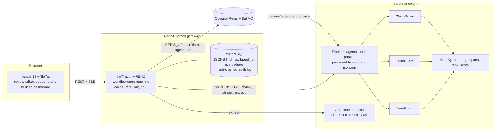

# Verity — Intelligent Brand Governance Platform
**Team Merge Conflicts** · Inkloom AI Hackathon, Brand Governance track · Round 2

> Every word. Every pixel. On brand.

AI agents check content against a brand's guidelines and explain every flag with the clause it breaks, a confidence score and a suggested fix.
People make the final call: a Creator → Manager → Approver workflow with a tamper-evident audit trail.
Nothing is published automatically.

**Try it:** open the live link and click **Start judge walkthrough**. No signup. A guided bar at the bottom walks through five steps.
Works on desktop and phone widths. **Live:** https://verity-two-delta.vercel.app  ·  API health: https://verity-api-f0xo.onrender.com/health/deep
(Free hosting: the first visit after a quiet period can take up to a minute to wake the API.)

## What you can do
| Role | Flow |
|---|---|
| Manager (Rajan) | Upload a PDF/DOCX/TXT/MD guideline (or use the sample), review and edit what was extracted, publish it as a new versioned Brand Intelligence Graph |
| Creator (Maya) | Write or load sample content, run the review, watch agents report in as they finish, accept / edit / dispute each flag, re-run to see the score change and a text diff, submit |
| Manager | Queue with score, open flags, change since last revision and age; override flags (reason required), add a flag the AI missed, comment, approve / reject (reason) / escalate |
| Approver (Anita) | Final approve or send back escalations; approved content exports as text, Markdown or JSON; "Mark as published" is a human action |
| Managers and approvers | Dashboard (score trend, violations by agent / content type / creator, clauses reviewers keep overriding) and the audit trail (verify the hash chain, export CSV/JSON) |

Seeded so nothing opens empty: one brand with guideline v1, 40 historical reviews in every state, notifications, and a prompt-injection test sample.

## Architecture

More detail: [docs/ARCHITECTURE.md](docs/ARCHITECTURE.md).

## The agents
| Agent | Does | How |
|---|---|---|
| ToneGuard | Voice and tone against the brand's tone rules | LLM with schema-validated structured output and up to 3 repair retries. The live demo runs a deterministic **basic mode** (see below) |
| TermGuard | Banned and approved terminology | Deterministic glossary match |
| ClaimGuard | Unsupported product claims | Finds claim-like sentences, then ranks them against the approved claims register (BM25, IDF-weighted coverage, typo-tolerant matching) and cites claim id, source document and page. A wrong number ("24 hours" vs the approved "48 hours") is flagged as a conflict even when the words match. "No supporting claim" is a distinct, explained outcome |
| MetaAgent | One clean result | Merges overlapping spans, ranks by severity and confidence, computes the 0–100 score, and tags low-confidence findings as suggestions |

Reliability built in: span verification (the server checks `text[start:end] == quoted_text`, re-locates or drops mismatches), one agent failing never blocks the others, a result cache keyed by content + guideline version, rate limiting, and a labelled precomputed result for the sample content if the AI service is unreachable. Other content is never faked.

**Learning loop.** Per rule, Verity tracks how often reviewers dispute or override its flags. Above 50% over at least 5 decisions the rule's confidence cutoff rises from 60% to 75%, so borderline findings become suggestions and stop lowering the score. The dashboard shows the cutoffs and flags the clause as possibly ambiguous.

**Security.** Roles are enforced server-side on every route (a creator token calling a manager endpoint gets 403, tested). Review content is passed to the model as delimited data, and a prompt-injection sample is included. Secrets live in environment variables only. The audit log is append-only: database triggers reject UPDATE, DELETE and TRUNCATE, and each entry hashes the previous one.

## Run locally
```bash
cp .env.example .env            # then export or copy the vars per service
cd ai  && python3 -m venv .venv && .venv/bin/pip install -r requirements.txt \
       && .venv/bin/uvicorn app.main:app --port 8000
cd api && npm install && PORT=4000 AI_SERVICE_URL=http://127.0.0.1:8000 npm start      # PGlite (in-process Postgres) if DATABASE_URL is unset
cd web && npm install && NEXT_PUBLIC_API_URL=http://127.0.0.1:4000 npm run dev
```
Open http://localhost:3000. No Docker is needed locally; set `DATABASE_URL` to use a real Postgres (see `docker-compose.yml`).

### Environment variables
| Variable | Service | Purpose |
|---|---|---|
| `JWT_SECRET` | api | Signs demo-login tokens |
| `WEB_ORIGIN` | api | Allowed browser origin (CORS) |
| `AI_SERVICE_URL`, `AI_SERVICE_TOKEN` | api, ai | Where the AI service is, and the shared secret between them |
| `DATABASE_URL` (`PGSSL=1` if needed) | api | PostgreSQL. Unset = in-memory PGlite (data lost on restart) |
| `SEED_HISTORY=off` | api | Skip the 40 demo reviews |
| `REDIS_URL`, `QUEUE_READY_TIMEOUT_MS` | api | Optional: run the review agents as BullMQ jobs. If Redis is unreachable the API falls back to the direct pipeline (waits at most `QUEUE_READY_TIMEOUT_MS`, default 3000) |
| `RUN_LIMIT_PER_MIN` | api | Review runs per user per minute (default 20) |
| `REDIS_URL` | api | Optional BullMQ queue for parallel agent jobs. Unset keeps the direct AI pipeline path |
| `SMTP_URL`, `MAIL_FROM` | api | Optional: real email. Without it, notifications are in-app only |
| `ANTHROPIC_API_KEY`, `MODEL_FAST` | ai | Optional: switches ToneGuard from basic mode to the LLM |
| `NEXT_PUBLIC_API_URL` | web | API base URL |

## Tests and evaluation
```bash
cd api && npm test            # 22 default-path tests + 3 Redis queue integration tests (skipped without REDIS_URL)
cd ai  && .venv/bin/python -m pytest -q     # 60 tests: spans, merge and scoring, term variants, tone lexicons, retrieval, extraction (real PDF/DOCX), streaming, calibration, prompt injection
cd web && npm test && npm run lint          # span-mapping tests + lint
cd web && npm run e2e         # 37 browser checks of the full journey on a running stack (needs Chrome)
cd web && npm run a11y        # axe-core audit: 11 pages and states in light and dark mode (0 violations)
cd web && npm run keyboard    # keyboard-only journey, tab order and reflow at 320 px / 200% zoom (15 checks)
cd ai  && .venv/bin/python scripts/eval.py  # precision / recall on the dev and held-out sets (30 texts each)
cd ai  && .venv/bin/python scripts/calibrate.py  # stated confidence vs measured precision
```
CI runs all of these plus `npm audit` and `pip-audit` ([.github/workflows/ci.yml](.github/workflows/ci.yml)).

**Measured (ToneGuard in basic mode).** Two annotated sets of 30 texts each: *dev* (used while building the agents) and *held-out* (written before the latest agent changes and never used to tune a rule or lexicon, so it is the fairer number).

| Agent | Dev (precision / recall) | Held-out before | Held-out now | Notes |
|---|---|---|---|---|
| TermGuard | 1.00 / 1.00 | 0.75 / 0.60 | 0.83 / 1.00 | Now catches singular and plural forms and hyphen or extra-space spellings. The two remaining false positives are "Java" meaning the language and "Joe's Diner"; a brand lists such cases as allowed contexts, and the sample brand does not list these two |
| ClaimGuard | 0.90 / 1.00 | 0.75 / 1.00 | 0.75 / 1.00 | Unchanged this round. Two held-out false positives |
| ToneGuard (basic mode) | 1.00 / 1.00 | 1.00 / 0.67 | 0.79 / 1.00 | Recall rose by adding categories (shouting, pressure, hype, jargon forms); precision fell because some extra flags are correct but were not annotated. Held-out labels were not changed to hide this |

**Calibration check** (`ai/scripts/calibrate.py`, 66 labelled findings): stated confidence against measured precision is 0.94 vs 0.91 for TermGuard, 0.83 vs 0.83 for ClaimGuard and 0.67 vs 0.88 for ToneGuard, so the hand-set values are about right to slightly cautious. The low-confidence boilerplate tier (0.58) measured 50% on 4 findings, which fits keeping it advisory. The sets are small and team-written, and the confidences are fixed numbers rather than model scores, so this is a sanity check, not proof.

**Latency (rules mode, 1,032-word draft, 10 runs):** first agent result 1 ms median (3 ms max), full review 2 ms median (3 ms max). LLM-mode latency has not been measured yet; the targets are a first result under 10 s and a full review under 60 s. **Queue overhead (same 1,032-word size, built-in sample cycled to length, local AI + Redis 8.2.10 on Windows, 10 runs):** direct AI endpoint 165.5 ms median; BullMQ path 197.1 ms; added median latency 31.5 ms. Reproduce with `cd api && npm run benchmark:queue` while Redis and the AI service are running.

## ToneGuard modes (disclosed deviation from the Round 1 plan)
ToneGuard is built to call an LLM. The live deployment runs it in **basic mode**, a deterministic rule set for jargon, hype words and exclamation marks, so the demo costs nothing and cannot hit rate limits. Every result is labelled "basic mode" in the UI and in the audit record (`agents[].mode = "fallback"`).
Switching needs only `ANTHROPIC_API_KEY` and `MODEL_FAST`; `ai/scripts/check_tone.py` verifies the live path.

## Deviations from Round 1 and known limitations
See the in-app page **/about** for the row-by-row table. In short: PostgreSQL JSONB replaces MongoDB; guideline extraction is rule-based rather than LLM-based; ClaimGuard uses lexical retrieval (BM25 plus weighted coverage) rather than embeddings in pgvector; the review runs in-process by default (asyncio), with optional BullMQ and Redis jobs when REDIS_URL is set; streaming uses server-sent events instead of Socket.IO; seeded demo logins replace Clerk; Liveblocks is dropped; AWS S3 waits for VisualGuard.
Also: scanned (image-only) PDFs are not read; the review cache and rate limiter are per API process; the tone profile has no embeddings yet; email is built but off unless `SMTP_URL` is set. The BullMQ path is optional and only active when `REDIS_URL` is set; the direct pipeline remains the default and supports the live demo without Redis.

## Round 3 roadmap
VisualGuard, multi-brand workspaces and Brand Drift Intelligence, with design, data model and acceptance tests, on the in-app page **/roadmap**. Groundwork already in the repo: the `brand_assets` table, a guarded upload route that answers 501, a `region` field on findings, `brand_id` on every table, and a second brand row.

## Disclosures
- **AI assistance.** The team used Claude (Anthropic) for help while building this project, including Claude Code for writing and testing parts of the code, the tests, and the documentation. The team directed the work and reviewed the result. Separately, the ToneGuard LLM path calls Anthropic's API when a key is configured; the live demo does not use it.
- **Open source.** Next.js, React, TipTap/ProseMirror, Express, FastAPI, Pydantic, PGlite, pypdf, python-docx, nodemailer and others, used under their own licences. Add a `LICENSE` file for the project's own code before submitting.
- **Demo data.** "Lumina Coffee Co." and every review, user and claim are fictional.

## Team
| Name | Role in Round 1 | Round 2 contribution |
|---|---|---|
| Swastik Sahu | Full-Stack Lead & AI/ML Engineer | |
| Akriti Tigga | Backend Engineer | |
| Gayathri VS | Frontend Engineer & UI/UX Designer | |
| Sakshi Kumari | AI / ML Engineer | |
| Shivam Agarwal | Backend Engineer & DevOps | Optional BullMQ and Redis review-agent jobs, AI endpoints, queue tests and documentation |


*(Add each member's Round 2 contribution here before submitting.)*

Accessibility and usability: [docs/USABILITY.md](docs/USABILITY.md) (the usability test with outside participants has not been run yet)

Full plan: [VERITY_ROUND2_PLAN.md](VERITY_ROUND2_PLAN.md) · Deploy: [DEPLOY.md](DEPLOY.md) · QA: [docs/QA_SCRIPT.md](docs/QA_SCRIPT.md) · Demo video script: [docs/DEMO_SCRIPT.md](docs/DEMO_SCRIPT.md) · Submission checklist: [docs/SUBMISSION.md](docs/SUBMISSION.md)
