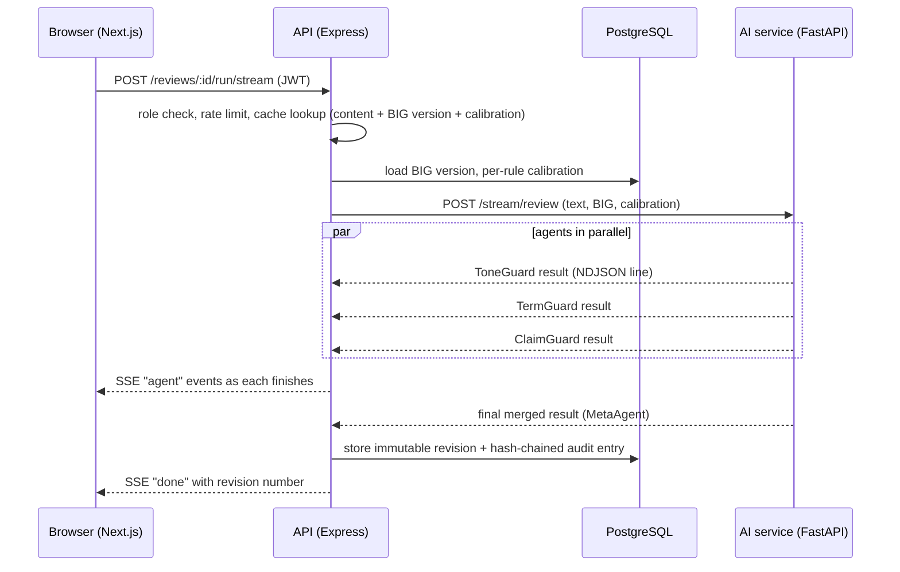

# Architecture

## Services
| Service | Responsibility |
|---|---|
| `web` | UI only. No business rules; every permission is re-checked by the API |
| `api` | Auth, RBAC, workflow state machine (draft → submitted → approved / escalated / changes requested → published), notifications, caching, rate limiting, audit log, analytics, guideline versioning |
| `ai` | Agents, MetaAgent, span verification, guideline extraction. Stateless: the BIG is sent with each request |
| PostgreSQL | System of record. JSONB for findings and BIG versions. `brand_id` on every table |

## Data model (key tables)
`orgs, brands, users, big_versions (immutable per version), reviews, revisions (immutable, one per AI run), flag_decisions (accepted / disputed / overridden / manual, with reason), comments, notifications, brand_assets (Round 3 groundwork), audit_log (append-only, hash-chained)`.

## Design decisions worth knowing
- **Span integrity.** Models are unreliable at character offsets, so they return the quoted text and the server computes and verifies offsets (`ai/app/spans.py`). Unicode is NFC-normalised once at ingestion. The editor maps plain-text offsets to ProseMirror positions (`web/lib/spanMap.js`) and decorations follow edits.
- **One agent failing never blocks a review.** Each agent has its own timeout and error boundary; the UI shows "unavailable, retry" for that agent only.
- **Four-eyes.** Nobody approves their own content; the API enforces it, not the UI.
- **Audit log.** One SQL statement computes each hash from the previous row, a unique constraint on `(brand_id, prev_hash)` prevents forks under concurrency, and triggers block UPDATE, DELETE and TRUNCATE. Verification recomputes the whole chain.
- **Learning loop.** Per-rule override rates (`api/src/calibration.js`) raise a rule's confidence cutoff; the AI service tags findings below the cutoff as suggestions and excludes them from the score.
- **Honest fallbacks.** Cached results are labelled "cached result" or "cached demo result". ToneGuard basic mode is labelled everywhere it appears.
