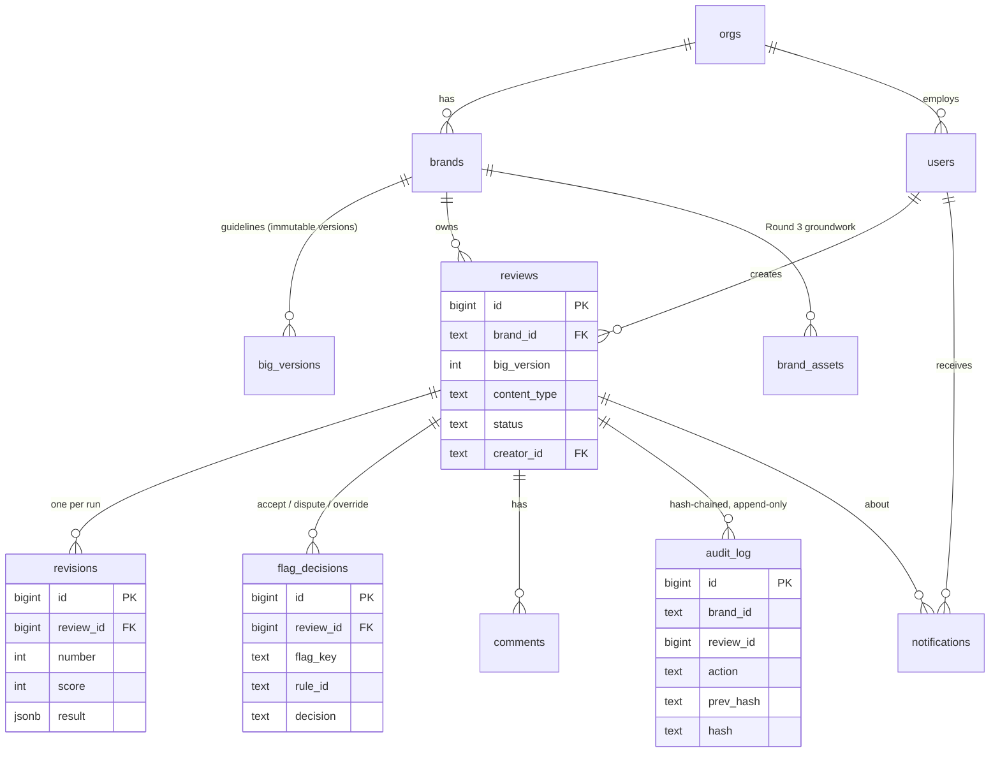

# Database

Postgres, with a migration runner in `api/src/db.js` (files in `api/migrations/`, applied in order, each recorded once in
`schema_migrations`). Locally and in tests the API uses PGlite, a real Postgres engine running inside Node, so no install is needed.
In production it connects to Neon through `DATABASE_URL`.

## Diagram

Every domain table carries `brand_id`, so supporting several brands in Round 3 is a change to the interface, not to the schema.
`audit_log` rejects `UPDATE`, `DELETE` and `TRUNCATE` with a trigger, and `UNIQUE (brand_id, prev_hash)` stops two writers
from forking the chain.

## Indexes and what they were measured to do

Migration `004_indexes.sql` adds five indexes. They were chosen from the queries the API runs, then measured; one candidate that
did not help was dropped.

**Method.** `node api/scripts/bulk-seed.js --reviews 20000` loads a throwaway in-process database with 20,000 reviews, 40,000
revisions, 60,000 flag decisions, 20,000 comments and 100,000 audit rows. It runs `EXPLAIN (ANALYZE)` on each query 7 times and
reports the median, first without the indexes and then with them. The demo data is never touched. The audit rows exist for volume
only: their hashes are placeholders, so that database would not pass the chain check.

**Results** (one run on a laptop, PGlite, so absolute numbers on Neon will differ; the direction and the plan changes are what matter):

| Query | Before (ms) | After (ms) | Plan after |
|---|---|---|---|
| Review list, manager, all rows (what `/reviews` did before pagination) | 118.6 | 114.5 | index scan, but still builds 20,000 rows |
| Review list, manager, first 50 | 14.0 | 0.07 | index scan on `reviews_updated_idx` |
| Review list, creator's own, first 50 | 4.95 | 0.07 | index scan on `reviews_creator_idx` |
| Audit trail for one review | 6.7 | 0.01 | bitmap index scan on `audit_review_idx` |
| Flag decisions of one review | 3.0 | 0.01 | index scan on `decisions_review_idx` |
| Comments of one review | 1.0 | 0.01 | index scan on `comments_review_idx` |
| Calibration (decisions per rule) | 20.9 | 20.7 | unchanged: sequential scan |
| Analytics: hours to approve | 87.5 | 87.7 | unchanged: sequential scan |
| Analytics: weekly score trend | 50.4 | 50.2 | unchanged: sequential scan |

**What this shows**
- The indexes make the lookups for one review, and the first page of a list, effectively instant at 20,000 reviews.
- They do **not** help the full list. Returning every row costs the same with or without an index, which is why the list
  endpoints are paginated (opt-in; see the API reference).
- They do **not** help the three dashboard aggregates. Those read every row on purpose, so an index cannot skip work. At this
  size they take 50 to 90 ms. If they ever need to be faster, the next step would be a summary table or a materialised view,
  which I have not built or measured.
- A `(brand_id, rule_id)` index on `flag_decisions` was tried and **dropped**: the calibration query groups every row, so the
  planner kept the sequential scan and the index only added write cost.

**Limits.** One machine, one data shape, an in-process Postgres. These numbers show that the plans changed and by how much on
this data; they are not a promise about Neon's latency.
